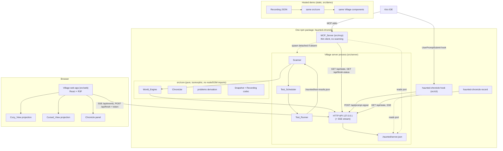
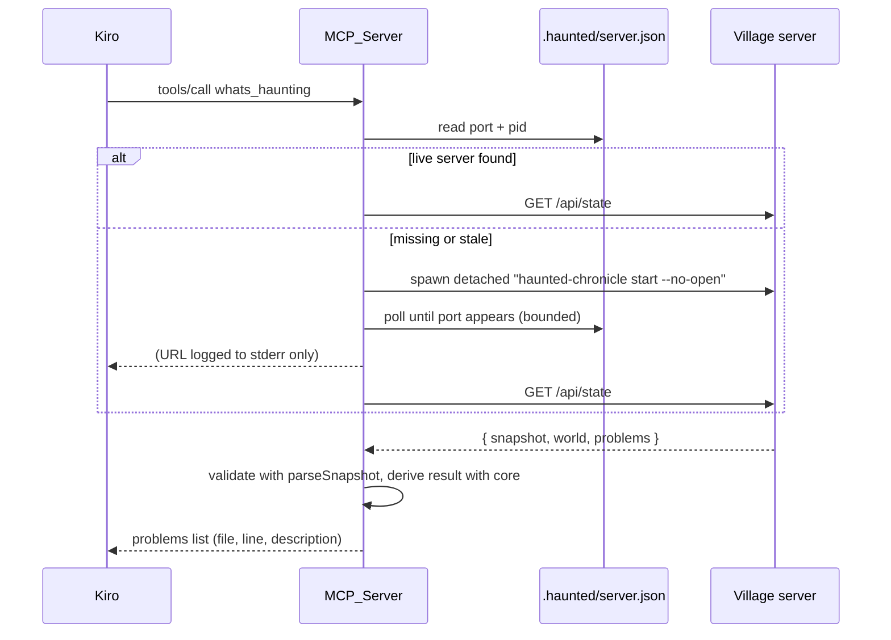
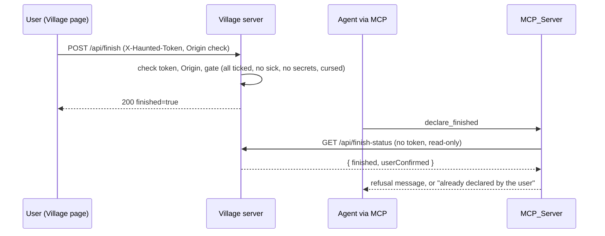

# Design Document

## Overview

Haunted Chronicle turns a code project into a 3D village. A pure, deterministic core (`World_Engine`) maps a `Snapshot` of the project (files, imports, tasks, test failures, secrets) onto a `World_State` (citizens, districts, sickness, gravestones, lanterns, tombstones, phase, `jinxSeq`). A thin Node shell (`Scanner`, `Server`, `Test_Runner`, `Test_Scheduler`) keeps the Snapshot current and serves it to a React Three Fiber browser app (`Village`) that renders either a concealed `Cozy_View` or the truthful `Cursed_View` of the same `World_State`. The `MCP_Server` and the Hook command are thin HTTP clients of that one village server. They never scan, watch, run tests, or compute a World_State.

The build order follows the requirement order: Scanner and Snapshot first, then the deterministic World_Engine and a minimal Village so the main loop (scan → derive → render) works end to end. Sickness/healing, the Chronicle, the MCP server, director mode, reduced motion, and the hosted demo are layered on top without changing the core contract.

Four design choices carry the whole feature:

1. **Pure core, dumb shell.** `World_Engine`, the Chronicler, hashing, layout, sickness, problem derivation, and the Snapshot/Recording codecs are plain TypeScript functions in `src/core` with no I/O and no `node:*` or DOM imports. They are importable from Node (server, CLI, MCP, tests) and from the browser (hosted demo, which has no server). **Time is never read inside core.** Every function that stamps time takes an injected `Clock` value (`nowMs: number`) from its caller. All side effects (file watching, HTTP, child processes) live in thin wrappers.
2. **Phase vs. View_Mode.** `Phase` (`cozy`/`cursed`) is server-side state that changes once, on the first Prompt_Signal. `View_Mode` is a client-only toggle for *how* the same `World_State` is drawn. The World_Engine never looks at `View_Mode`; concealment is a pure rendering-time projection (`Cozy_View`/`Cursed_View`) applied in the browser only. This gives requirement 7.17's concealment invariance and requirement 21.9's "World_Engine is blind to View_Mode" for free.
3. **One village server per Project, everyone else is a client.** Only the village server owns the Scanner, Test_Scheduler, and World_State. The browser, the MCP_Server, the Hook command, and the `record` command all talk to it over loopback HTTP.
4. **One npm package.** Everything ships as a single package with one bin, `haunted-chronicle`, runnable with `npx github:Oreva-Dev9112/haunted-chronicle` or `npm link`.

## Architecture



The Village page receives `World_State` updates through a Server-Sent Events stream (`GET /api/events`). The Village never computes `World_State` itself when live. Only the Demo does, feeding Recording snapshots through the same `World_Engine` in the browser (requirement 19.5). SSE replaces a WebSocket because the stream is one-way (server to browser), needs no extra dependency, and reconnects automatically; browser-to-server actions are plain POSTs.

### Sequence: Kiro asks what is haunting the project



### Sequence: the user declares "It is finished"



## Package, Module Layout and Build

### Single package layout

```
package.json                    # name: haunted-chronicle, type: module, bin, files, scripts
tsconfig.json                   # paths: @core/* -> src/core/*
tsup.config.ts                  # node ESM build for src/cli, src/server, src/mcp
vite.config.web.ts              # build the Village app  -> dist/web
vite.config.demo.ts             # build the hosted demo  -> dist/demo
vitest.config.ts                # same aliases as tsconfig
public/models/kit.glb           # shipped model kit (copied into dist/web by Vite)
src/
  core/                         # pure, no node:* / DOM / react imports, no Date.now()
    types.ts                    # FileNode, Task, Citizen, District, WorldState, Event, ...
    snapshot.ts                 # Snapshot type + printSnapshot / parseSnapshot
    hash.ts                     # citizenSeed(path): 32-bit hash
    layout.ts                   # village layout from Snapshot + TombstoneSet
    sickness.ts                 # Sickness_Source selection + reverse-BFS spread
    tasks.ts                    # Task -> District/Castle assignment
    secrets.ts                  # secret pattern matching
    world.ts                    # deriveWorldState, applyPromptSignal, applyFinishDeclaration
    events.ts                   # Event derivation between consecutive World_States (atMs from ctx)
    chronicle.ts                # Chronicler: Event -> Chronicle_Entry (templates, atMs grouping)
    problems.ts                 # deriveProblems(snapshot, world): shared by server and MCP
    view.ts                     # cozyView / cursedView projections
    recording.ts                # Recording type + printRecording / parseRecording
    finished.ts                 # Finished-flag gate logic
    api.ts                      # StateResponse type + parseStateResponse (shared HTTP contract)
  server/                       # Node only
    scanner/{watch,imports,gitignore}.ts
    test-runner/{scheduler,runner}.ts
    server-info.ts              # .haunted/server.json read / exclusive create / liveness probe
    token.ts                    # per-server random finish token
    http.ts                     # HTTP API, SSE, static web build, token embedding
    start.ts                    # start the village server (used by `start` and by MCP spawn)
  mcp/
    client.ts                   # discover/ensure server, fetch /api/state with timeouts
    tools.ts                    # whats_haunting, world_status, declare_finished
    prompt.ts                   # whats-haunting-my-world
    index.ts                    # stdio transport, logs to stderr only
  cli/
    index.ts                    # bin entry (shebang), subcommand dispatch
    hook.ts                     # `hook` subcommand
    record.ts                   # `record` subcommand
    config.ts                   # `config hook` / `config mcp` snippet printers
  web/                          # Village browser app (React + R3F), imports @core only
    scene/ (VillageScene, Citizen, InkOutline, camera/DirectorMode)
    ui/ (StatsCard, ChroniclePanel, Toggles, IntroOverlay)
    state/ (useWorldStream, viewMode)
    main.tsx
  demo/
    recordingPlayer.ts          # feeds Recording frames to src/core using recorded atMs
    main.tsx                    # reuses src/web components
    recording.json              # the shipped Recording
```

`src/web` and `src/demo` share `scene/` and `ui/`. `src/server`, `src/mcp`, `src/cli`, `src/web`, and `src/demo` depend on `src/core` and never on one another (the CLI imports `server/start` and `mcp/index` as entry points only).

### Bin and subcommands

One bin, `haunted-chronicle` → `dist/cli.js` (ESM, shebang, executable). Subcommands:

| Subcommand | Purpose |
| --- | --- |
| `start` (default) | Start the village server, or print the URL of the live one (req 1, 23). Flag `--no-open` skips opening a browser. |
| `mcp` | Run the MCP_Server over stdio (thin client, see below). |
| `hook` | Send the Prompt_Signal and exit 0 always (see Hook). |
| `record --out <file>` | Connect to the live village server and write a Recording (req 19.9). |
| `config hook` | Print the `.kiro/hooks/haunted-chronicle.json` definition. |
| `config mcp` | Print the Kiro MCP configuration snippet (req 16.8). |

Both `config` snippets embed the command in the form that works for how the tool was installed: `node <absolute path to dist/cli.js> <subcommand>`. This avoids `npx` start-up latency in the hook, which must stay well under 2 seconds.

### Build and scripts

- **Node build (tsup, ESM, target node20):** entries `src/cli/index.ts`, `src/server/start.ts`, `src/mcp/index.ts` → `dist/`. tsup bundles `@core/*` into each entry, so `dist` has no unresolved alias.
- **Web build (Vite):** `vite build -c vite.config.web.ts` → `dist/web`. Vite copies `public/models/kit.glb` to `dist/web/models/kit.glb`, which the Village loads from `/models/kit.glb` (req 6.1). The server serves `dist/web` as static files.
- **Demo build (Vite):** `vite build -c vite.config.demo.ts` → `dist/demo`, a static site containing the scene bundle and `recording.json`. It has no server code (req 19.1).
- **Scripts:** `build:node`, `build:web`, `build:demo`, `build` (all three), `test` (`vitest --run`), `lint`, `prepare` (`npm run build:node && npm run build:web`; the demo build is not needed for installs and runs in `build`, which the hosting step calls).
- **Install from GitHub:** `dist` is not committed, so `prepare` produces it. npm runs `prepare` when installing a package from a git URL (including `npx github:Oreva-Dev9112/haunted-chronicle`) and installs the devDependencies it needs (tsup, vite, typescript) for that step. The first `npx` run is therefore slow because it builds. `npm link` runs `prepare` too.
- **`files` field:** `["dist", "public/models/kit.glb"]`. `bin` is `{ "haunted-chronicle": "dist/cli.js" }`. Runtime `dependencies` hold only what `dist` needs at runtime (the MCP SDK, chokidar, es-module-lexer, ignore). React, R3F, three, and Vite are devDependencies, since the web build is bundled.

### Core purity

`src/core` may import only from `src/core` and from type-only or pure packages. A Vitest test (`tests/core-purity.test.ts`) scans every file under `src/core` and fails on any import of `node:*`, a bare Node builtin (`fs`, `path`, `child_process`, ...), `react`, `three`, or `@react-three/*`, and on any use of `Date.now`, `new Date(`, `performance.now`, `Math.random`, or `process.`. An ESLint `no-restricted-imports` / `no-restricted-globals` override for `src/core/**` enforces the same rules in the editor and in `npm run lint`.

## Components and Interfaces

### Scanner (`src/server/scanner`)

- Walks the Project respecting `.gitignore`, `.git`, `node_modules`, `.haunted` (req 2.2, 2.7).
- Watches with `chokidar`, debounced to publish an updated `Snapshot` within 1s of a change (req 2.3, 9.8, 10.2).
- For `.js/.jsx/.ts/.tsx` files, extracts static import/export specifiers with `es-module-lexer` and resolves relative specifiers against files in the Snapshot (req 3.1–3.4); unparseable files are kept with no outgoing edges.
- For `.kiro/specs/*/tasks.md`, extracts checkbox lines (`- [ ] text` / `- [x] text`) with spec name and line number (req 9.1).
- Reads `.haunted/test-results.json` (Vitest JSON reporter output) when present and valid (req 10.1, 10.15–10.16).
- Scans text files ≤1MB for secret patterns (req 11.1, 11.5).
- Caps File_Nodes at 300 in path-sorted order, recording the omitted count (req 2.5).
- Produces Snapshots independent of filesystem listing order by sorting paths before emitting (req 2.6).

The Scanner exists only inside the village server process. No other component imports it.

### Test_Scheduler / Test_Runner (`src/server/test-runner`)

- A small explicit state machine: `idle → debouncing → running → (debouncing if changes arrived during the run)`.
- Vitest detection: `vitest` in `package.json` deps, or a `vitest.config.*`/`vite.config.*` with a `test` block (req 22.1).
- 2s debounce (±250ms tolerance) from the last file change; one run at a time; exactly one queued follow-up (req 22.2, 22.6, 22.7); ignores changes under `.haunted` (req 22.4); schedules an initial run at startup (req 22.3).
- Runs `vitest run --reporter=json`, writes to `.haunted/test-results.json.tmp`, renames atomically on completion (req 22.8); 120s timeout kills the process and discards output, leaving the previous report untouched (req 22.9).

### World_Engine (`src/core/world.ts`)

All entry points are pure. The caller supplies the clock:

```ts
interface EngineCtx { nowMs: number }   // injected; core never reads a clock

function deriveWorldState(
  snapshot: Snapshot,
  previous: WorldState | null,          // carries tombstones, phase, jinxSeq, finished, nextSeq, ever-seen paths
  ctx: EngineCtx
): { world: WorldState; events: Event[] }

function applyPromptSignal(world: WorldState, ctx: EngineCtx): { world: WorldState; events: Event[] }
function applyFinishDeclaration(world: WorldState, ctx: EngineCtx): { world: WorldState; events: Event[] }
```

`deriveWorldState` computes citizens (seed → appearance), layout, task assignment, sickness, gravestones, freed districts/lanterns, and tombstones (diff against `previous`). It carries forward `phase`, `jinxSeq`, and `finished`, which change only through `applyPromptSignal` and `applyFinishDeclaration`, plus the automatic clearing of `finished` in req 13.5. Each emitted Event receives the next `seq` from `world.nextSeq` and `atMs = ctx.nowMs`.

`applyPromptSignal` on a `cozy` world sets `phase = 'cursed'`, sets `jinxSeq` to the `seq` of the new `first_prompt` event, and emits that event. On a `cursed` world it returns the world unchanged with no events (req 8.7).

### Problem derivation (`src/core/problems.ts`)

```ts
interface Problem {
  kind: 'sickness_source' | 'sick_by_import' | 'secret' | 'task';
  path: string | null;       // null only for Castle tasks that name no file
  line: number | null;
  description: string;
}
function deriveProblems(snapshot: Snapshot, world: WorldState): Problem[]
```

This is the single implementation of req 16.4. The village server uses it to fill `problems` in `/api/state`. The MCP_Server calls the same function on the Snapshot and WorldState it received over HTTP, so a result never depends on code that scans or computes a world in the MCP process. It reads the real World_State and ignores `Phase` and `View_Mode` (req 16.12, 21.11).

### Village server HTTP API (`src/server/http.ts`)

All routes bind to `127.0.0.1` only (req 1.3, 23.9). Any request whose `Host` header is not `127.0.0.1:<port>` or `localhost:<port>` is rejected with 403, which blocks DNS-rebinding.

| Route | Caller | Behaviour |
| --- | --- | --- |
| `GET /__haunted_ping` | start / hook / MCP liveness probe | `{ app: "haunted-chronicle", projectRoot, pid }` |
| `GET /api/state` | MCP, `record`, tests | `{ snapshot, world, problems, serverTimeMs }`. Contains no token. Real state, never concealed. |
| `GET /api/events` | Village page, `record` | SSE stream. First message is the full `world`; later messages are `world` updates. Chronicle entries are inside `world.chronicle`. |
| `POST /api/prompt-signal` | Hook, "Send first prompt" button | Applies `applyPromptSignal` once. Idempotent, returns `{ phase }`. Needs no token, because the hook cannot hold one and a prompt signal only starts the story. |
| `POST /api/finish` | Village page button only | Requires header `X-Haunted-Token` equal to the server token, and an `Origin` header equal to `http://127.0.0.1:<port>` (or `localhost`). On success runs the gate in `finished.ts` and `applyFinishDeclaration`. Returns 403 for a bad token or origin, 409 when the gate conditions do not hold. |
| `GET /api/finish-status` | MCP `declare_finished` | `{ finished, canDeclare }`. Read-only. |
| `GET /` and static files | Browser | Serves `dist/web`. `index.html` is served with the token injected. |

**Finish authentication.** At server start, `token.ts` creates a 128-bit random token (`crypto.randomBytes(16)`, hex). The server substitutes it into `index.html` as `<meta name="haunted-token" content="…">` on each response to `GET /`. The Village page reads the meta tag and sends it on `POST /api/finish`. The token is held in server memory only. It is not written to `.haunted/server.json`, not included in `/api/state`, `/api/events`, `/api/finish-status`, or `/__haunted_ping`, and not available to the MCP_Server, which never requests `GET /` and has no code path that calls `/api/finish`. The `Origin` check adds protection against other web pages in the user's browser. This guard keeps the MCP tool and normal agent tool calls from finishing the project. It cannot stop a process that already has local shell access from fetching `/` and reading the token, so the design makes no claim against that. The token changes on every server start.

### Village (`src/web`, `src/demo`)

- Renders a hex-tile island using `InstancedMesh` per model index from `/models/kit.glb` (see `reference/README.md`'s model index table), one instance per house, loaded via `GLTFLoader` from the static asset.
- Builds either `cozyView(worldState)` or `cursedView(worldState)` (from `src/core/view.ts`) each time `World_State` or `View_Mode` changes, and renders only that projection.
- Ink-outline postprocessing pass, face sprites, zoom controls, stats card, intro overlay, Chronicle panel, Director_Mode camera rig, Reduced_Motion handling. These are new implementations inspired by `reference/look/Big3.tsx`, written against the real data model.

### MCP_Server (`src/mcp`): a thin client

The MCP_Server performs **no** file scanning, watching, test running, import parsing, secret matching, or World_State computation. Its only inputs are the village server's HTTP responses and `.haunted/server.json`.

**Ensure the server (`client.ts`).**

1. Read `.haunted/server.json`. If it holds a port and a live pid, probe `GET /__haunted_ping` (timeout 500 ms). A matching `projectRoot` means live.
2. If missing or stale, spawn the village server as a detached child process: `child_process.spawn(process.execPath, [<dist>/cli.js, 'start', '--no-open'], { detached: true, stdio: 'ignore', cwd: projectRoot }).unref()`. The server outlives the MCP process, so the browser keeps working when Kiro restarts the MCP server. An in-process start is not used, because the village would then die with the MCP session.
3. Poll `server.json` and the ping route every 200 ms for up to 10 s. On success, log the village URL to **stderr** (req 23.5). On timeout, fail the tool call with an error text (see Error Handling).
4. Two starters at once are resolved by the server's exclusive create (see One server per project). The loser's spawned child exits, and the MCP client follows `server.json` to the winner.

**Tools.** Each tool call runs "ensure the server", then one `GET /api/state` with a 3 s timeout, validates it with `parseStateResponse`, and builds its result with core functions:

- `whats_haunting`: `deriveProblems(snapshot, world)` mapped to `{ path, line, description }` items (req 16.3, 16.4, 16.9, 16.10). An empty list is a valid result.
- `world_status`: counts and flags read from `world` (req 16.5).
- `declare_finished`: calls `GET /api/finish-status` and never sets the flag. It returns the refusal message that only the user can declare it finished, or, when `finished` is already true, a message that the user already declared it (req 16.6).
- Prompt `whats-haunting-my-world` returns fixed text telling Kiro to call `whats_haunting` and fix the listed problems (req 16.7).

stdout carries only MCP protocol messages; all logs go to stderr (req 23.6).

### Hook (`src/cli/hook.ts`, generated hook definition)

`haunted-chronicle hook` does the following, in order:

1. Drain stdin without parsing it (Kiro passes a JSON context; the command does not need it).
2. Read `<cwd>/.haunted/server.json`. If it is missing, unreadable, not valid JSON, or has no numeric `port`, exit 0.
3. If `pid` is present and `process.kill(pid, 0)` throws `ESRCH`, the file is stale: exit 0.
4. `POST http://127.0.0.1:<port>/api/prompt-signal` with a 500 ms hard timeout (`AbortSignal.timeout(500)`), well under the 2 s limit of req 8.3.
5. On any outcome (success, refused connection, timeout, non-2xx, thrown error), exit 0. The command writes nothing to stdout or stderr, so it never alters or blocks the prompt. The whole body sits in a `try/catch`, and `process.exit(0)` runs in a `finally`.

`haunted-chronicle config hook` prints this definition for `.kiro/hooks/haunted-chronicle.json`:

```json
{
  "version": "v1",
  "hooks": [
    {
      "name": "Haunted Chronicle prompt signal",
      "trigger": "UserPromptSubmit",
      "action": {
        "type": "command",
        "command": "node /absolute/path/to/dist/cli.js hook"
      }
    }
  ]
}
```

### Server entry and one-server protocol (`src/server/start.ts`, `server-info.ts`)

Binds loopback only (req 1.3, 23.9). Startup order: (1) try `fs.open('.haunted/server.json', 'wx')` as the lock and write `{ pid, port: null, projectRoot }`; (2) bind the HTTP server, choosing the next free port if needed (req 1.4); (3) rewrite the file atomically with the real `port`. A reader that sees `port: null` and a live pid waits, polling for up to 10 s, rather than starting a second server. On clean shutdown the file is removed (req 23.1).

## Data Models

```ts
// src/core/types.ts

interface Snapshot {
  projectName: string;
  files: FileNode[];              // path-sorted
  omittedFileCount: number;       // req 2.5
  importEdges: ImportEdge[];      // path-sorted, from -> to
  tasks: TaskRecord[];
  testFailures: TestFailure[];
  secretFindings: SecretFinding[];
}

interface FileNode { path: string; }           // project-relative; folder = dirname(path)
interface ImportEdge { from: string; to: string; }
interface TaskRecord { specName: string; line: number; text: string; done: boolean; }
interface StackFrame { path: string; line: number; }
interface TestFailure { testFile: string; message: string; stackFrames: StackFrame[]; }
interface SecretFinding { path: string; line: number; pattern: string; }

// --- World_State ---

interface WorldState {
  phase: 'cozy' | 'cursed';
  jinxSeq: number | null;           // seq of the first_prompt event; null while cozy
  finished: boolean;
  nextSeq: number;                  // next event/entry sequence number
  citizens: Citizen[];
  districts: District[];
  castle: Castle;
  tombstones: Tombstone[];
  chronicle: ChronicleEntry[];      // closed entries, full history incl. pre-JINX
  chronicleOpen: OpenGroup[];       // groups still inside their 3 s window
  everSeenPaths: string[];          // paths that were File_Nodes in any Snapshot this session
  omittedFileCount: number;
}

interface Citizen {
  path: string;
  seed: number;                    // 32-bit
  name: string; faceVariant: number; houseModel: number; houseColor: number;
  sick: boolean;
  hasGravestone: boolean;
  districtId: string;              // or castle
  tile: { q: number; r: number };
}

interface District {
  id: string;                      // folder path
  citizenPaths: string[];
  taskIds: string[];
  dark: boolean;                   // has >=1 unticked task
  sick: boolean;                   // has >=1 sick citizen
  freed: boolean;                  // all tasks done, no sick, no gravestone
  seedAnchor: { q: number; r: number };
}

interface Castle { taskIds: string[]; dark: boolean; }
interface Tombstone { path: string; tile: { q: number; r: number }; diedAtEventSeq: number; }

// --- Events (derived, not stored in Snapshot) ---
// Every Event carries seq (ordering) and atMs (milliseconds from the injected clock).

type EventBase = { seq: number; atMs: number };
type Event = EventBase & (
  | { type: 'first_prompt' }
  | { type: 'citizen_sick'; path: string }
  | { type: 'sickness_spread'; path: string; fromPath: string }
  | { type: 'citizen_healed'; path: string }
  | { type: 'secret_found'; path: string; line: number }
  | { type: 'secret_removed'; path: string }
  | { type: 'district_freed'; districtId: string }
  | { type: 'task_ticked'; specName: string; line: number }
  | { type: 'citizen_born'; path: string }
  | { type: 'citizen_died'; path: string }
  | { type: 'finished' }
);

interface OpenGroup { type: Event['type']; anchorAtMs: number; events: Event[]; }

interface ChronicleEntry {
  seq: number;                     // seq of the first event in the group
  atMs: number;                    // atMs of the first event in the group
  eventType: Event['type'];
  text: string;                    // <= 30 words, no emoji
  evidence: { path: string; line?: number; detail?: string };
  representedCount: number;        // >=1 when grouped
}

// --- HTTP contract (src/core/api.ts) ---
interface StateResponse { snapshot: Snapshot; world: WorldState; problems: Problem[]; serverTimeMs: number; }

// --- Recording (hosted demo) ---
// atMs is milliseconds since the start of the recording, non-decreasing.
interface Recording {
  frames: { atMs: number; snapshot: Snapshot; signal?: 'prompt' | 'finish' }[];
}
```

`WorldState` is the only thing the Village renders; `Snapshot` and `Event` never reach the browser in the live Tool. Both travel inside a `Recording` for the Demo (events are re-derived there). The demo player calls `deriveWorldState` and `applyPromptSignal` with `ctx.nowMs = frame.atMs`, so a replay is deterministic and independent of the viewer's clock. The `record` command writes `atMs` as the server clock minus the recording start; core does not read a clock.

## Key Algorithms

### Citizen_Seed (hash)

FNV-1a 32-bit over the UTF-8 bytes of the project-relative path:

```ts
function citizenSeed(path: string): number {
  let h = 0x811c9dc5;
  for (let i = 0; i < path.length; i++) { h ^= path.charCodeAt(i); h = Math.imul(h, 0x01000193); }
  return h >>> 0;
}
```

Appearance (name, face variant, house model, house colour) is derived purely from `citizenSeed`, so identical paths always yield identical citizens (req 4.1–4.5).

### Layout

1. Build a hex ring/spiral (axial coordinates) around the centre tile, reserved for the Castle (req 5.5).
2. For each folder (sorted by path), seed a district anchor on a ring at an angle derived from a hash of the folder path, then BFS-flood-fill outward from the anchor over free tiles, claiming one tile per `FileNode` in that folder, skipping tiles occupied by a `Tombstone` (req 5.3, 5.4, 24.7).
3. Process folders and files in a fixed sort order so results don't depend on Snapshot array order (req 5.2, 2.6).
4. **Incremental stability**: replay the previous assignment for every path still present, then flood-fill only newly-added paths into the first free tiles in their district (req 5.6).

### Sickness: source selection + reverse BFS

For each `TestFailure`:

1. Walk `stackFrames` in order; select the first frame that is inside the Project, not under `node_modules`, not equal to `testFile`, and whose `path` is a `FileNode` in the Snapshot → that is a `Sickness_Source` (req 10.3–10.4).
2. If none qualifies, the Sickness_Sources are the direct (one-hop) import targets of `testFile` in `importEdges` (req 10.5).
3. Mark every Sickness_Source **and** every `testFile` of a failing test as sick (req 10.6–10.7).
4. Build the reverse import graph once per Snapshot; run BFS from the union of all Sickness_Sources and failing Test_Files; every reached node is sick (req 10.8–10.9). The visited set guarantees termination on cycles (req 10.10).
5. Record, per failure, the chosen frame's `{path, line}`, or `{testFile, line of the failing test}` when sourced from imports (req 10.11).

### Task assignment

A task is assigned to the District of every existing folder/file path it mentions (substring match against known Snapshot paths, longest-path-first); if it mentions no existing path, it goes to the Castle; mentions of non-existent paths are ignored (req 9.2–9.4, 9.7).

### Secret patterns

Three regexes scanned per line of eligible text files (≤1MB, not binary): API-key-like assignment, private-key PEM header, generic `token`/`secret` assignment to a long opaque string. Only `{path, line, patternName}` is retained (req 11.1–11.2).

### Chronicle templates and grouping

- One template family per `Event['type']` (req 14.9), each with several variants selected by `citizenSeed(event.path) % variantCount` so identical events render identical text (req 14.6). Events without a path (`first_prompt`, `finished`) use the Castle's name as the evidence anchor and a fixed variant.
- Text is composed from fixed strings plus the file's basename, with no model call (req 14.5), and is checked at generation time to stay ≤30 words with no emoji (req 14.2–14.3).
- An entry's `evidence.path` must be in `world.everSeenPaths` (current or earlier in the session); otherwise no entry is generated (req 14.4, 14.8).
- **Grouping by `atMs`.** The Chronicler is a pure reducer `reduceChronicle(world, events, ctx) → world'` that uses only `event.atMs` and `ctx.nowMs`, never a wall clock:
  1. For each event in `seq` order, find the open group of the same `type`. If none exists, or `event.atMs - group.anchorAtMs > 3000`, close that group (emit its entry) and open a new group anchored at `event.atMs`. Otherwise append the event to the group.
  2. At the end of each call, close every open group with `ctx.nowMs - anchorAtMs >= 3000`. The server calls the reducer on a timer tick with `events = []`, so quiet groups close without new events.
  3. A closed group becomes one entry: `seq` and `atMs` from the first event, `representedCount = events.length`, and the representative file is the event path with the lowest `citizenSeed` (ties by path), so the choice is deterministic. This applies to "citizen born" and "citizen died" groups as well (req 14.7).
- The Chronicler is phase-blind and always runs on the real history (req 15.9). The Chronicle panel shows only entries with `seq >= world.jinxSeq`, and none while `jinxSeq` is null (req 15.8). Because a group takes the `seq` of its first event, a group that opened before the JINX stays hidden even if it closed after it.

### Test scheduler (state machine)

States: `idle`, `pendingRun(dueAtMs)`, `running(startedAtMs)`, `runningWithFollowUp`. The transition table is a pure reducer `(state, event: 'file_changed' | 'run_completed' | 'clock_tick', nowMs) -> state'` so tests can drive it with plain numbers (supports P22). It lives in `src/server/test-runner` because it is used only by the server, but it imports no Node APIs.

### One server per project

`server-info.ts` follows the lock-then-bind order in the Server entry section. If `wx` fails because the file exists, the caller reads it, checks `pid` with `process.kill(pid, 0)`, and probes `/__haunted_ping` for a matching `projectRoot`. If live (or still starting with `port: null` and a live pid), it attaches or prints that URL and does not bind a second server. If stale, it deletes and retries the exclusive create once, so two simultaneous starters cannot both win (req 23.2–23.4, 23.8). The MCP_Server and the `start` command share this code through `server-info.ts`; the MCP client only adds the "spawn `start` detached and wait" step.

### Snapshot / Recording codec

`snapshot.ts` exports `printSnapshot(s) -> string` (`JSON.stringify` of a canonicalized, key-sorted structure) and `parseSnapshot(json) -> Snapshot | { error: string }`, validating required fields and reporting the first invalid field by name (req 20.1–20.4). `recording.ts` follows the same pattern and additionally rejects a frame list whose `atMs` values decrease (req 19.8). `api.ts` exports `parseStateResponse`, which the MCP client uses to reject malformed server replies without throwing.

## Concealment: Cozy_View vs. Cursed_View, and the Reveal

`view.ts` exports two pure projections from `WorldState` to a `VillageViewModel` (the only shape the `scene/` components read):

- `cursedView(ws)`: the full truth: sick tint and face, gravestones, dark districts/castle, red glow, tombstones, lanterns, and Chronicle entries filtered to `seq >= ws.jinxSeq` (empty while `jinxSeq` is null).
- `cozyView(ws)`: same citizens/districts/layout, but every citizen forced to a happy face with no red tint, no gravestones/tombstones/lanterns, no dark/glow district styling, no Chronicle panel, and a stats card restricted to `{projectName, fileCount, districtCount}` (req 7.10–7.14).

Both are pure functions of `WorldState` alone (never of history or a clock), so `cozyView` cannot depend on sickness, secrets, or tasks held in that state (req 7.17, P24).

`View_Mode` (client state) selects which projection is drawn and is independent of `Phase` (server state):

| Phase | View_Mode | What renders |
|---|---|---|
| cozy | Cozy | `cozyView` |
| cozy | Cursed | `cursedView` as a preview; Phase stays `cozy`, `jinxSeq` stays null, no JINX plays (req 8.14) |
| cursed | Cozy | `cozyView` (req 8.15) |
| cursed | Cursed | `cursedView` |

The **Reveal** (req 8.10–8.13) is a client-side transition. When the streamed `world` changes from `phase: 'cozy'` to `phase: 'cursed'` (that is, `jinxSeq` goes from null to a number), the Village plays the flash or fade and then swaps the active projection from `cozyView(ws)` to `cursedView(ws)` for the current `ws`. It never replays intermediate states, so the end of the Reveal equals `cursedView(ws)` (P25). Entries stored before `jinxSeq` stay hidden because the panel filter is `seq >= jinxSeq`. Reduced_Motion swaps the flash for a cross-fade of the same two projections.

The MCP_Server and Chronicler always read the real `WorldState`/Snapshot and take no `View_Mode` parameter (req 16.12, 21.11), so the type system enforces it.

## Correctness Properties

*A property is a characteristic or behavior that should hold true across all valid executions of a system — essentially, a formal statement about what the system should do. Properties serve as the bridge between human-readable specifications and machine-verifiable correctness guarantees.*

### Property 1: Determinism of World_Engine

For all Snapshots `S`, Tombstone sets `T`, and clock values `c`, `deriveWorldState(S, T, {nowMs: c})` called twice yields equal results, and yields an equal `WorldState` when `S`'s file/edge/task arrays are shuffled first.

**Validates: Requirements 2.6, 5.1, 5.2**

### Property 2: Citizen identity from path only

For all paths `p1`, `p2` and any two Snapshots, if `p1 === p2` then their derived Citizen appearance and name are equal; for any path `p`, changing only the file's content (not its path) leaves the derived Citizen unchanged.

**Validates: Requirements 4.1, 4.2, 4.3, 4.4**

### Property 3: Layout validity

For all Snapshots and Tombstone sets, no two houses occupy the same tile, no house occupies a tile held by a Tombstone, and every house's tile lies within its folder's District region.

**Validates: Requirements 5.3, 5.4, 24.7**

### Property 4: Layout stability under addition

For all Snapshots `S` and a new file added to `S` producing `S'`, the tile of every house present in both `S` and `S'` is unchanged.

**Validates: Requirements 5.6**

### Property 5: Sickness source and spread equals the reference model

For all generated Import_Graphs (including cyclic ones), Test_Files, and failures with Stack_Frames (including frames in `node_modules`, in the Test_File, or outside the Snapshot), the computed Sick set equals a reference implementation that (a) selects Sickness_Sources as specified and (b) reverse-BFS-reaches from Sickness_Sources and failing Test_Files.

**Validates: Requirements 10.3, 10.4, 10.5, 10.6, 10.7, 10.8, 10.9, 10.10**

### Property 6: Healing is the inverse of sickening

For all Snapshots with failures, removing all failures yields zero Sick Citizens and zero Sick Districts; for all Snapshots, adding a failure and then removing it again yields a World_State equal to the one before the failure was added (ignoring `nextSeq`, `chronicle`, and `chronicleOpen`, which record history).

**Validates: Requirements 12.1, 12.8**

### Property 7: Truthfulness of World_State and whats_haunting

For all Snapshots, every path appearing in a Task, test failure, Sickness_Source, or secret finding in the derived World_State and in the problems list exists in the Snapshot, except a Tombstone or a "citizen died" Evidence_Line (whose path existed in some Snapshot of the session); no Tombstone is ever counted or rendered as a Citizen. For all `StateResponse` values, the MCP tool result built by `whats_haunting` equals `deriveProblems(response.snapshot, response.world)` mapped to `{path, line, description}`, and does not vary with `Phase`.

**Validates: Requirements 16.4, 21.1, 21.2, 21.3, 21.4, 21.5, 21.6, 21.7, 21.8**

### Property 8: Task assignment correctness

For all generated Tasks and Snapshots, a Task mentioning no existing path is assigned only to the Castle; a Task mentioning existing paths is assigned only to the Districts of those paths' folders; mentions of non-existent paths contribute no assignment.

**Validates: Requirements 9.2, 9.3, 9.4, 9.7**

### Property 9: Freed District iff fully clean

For all Snapshots, a District is Freed if and only if all its Tasks are ticked, none of its Citizens is Sick, and none of its houses has a Gravestone.

**Validates: Requirements 12.3, 12.5**

### Property 10: Chronicle entry shape

For all Events (each with an arbitrary `atMs`), the generated Chronicle_Entry's text contains at most 30 words and no emoji character, its Evidence_Line names a path in `everSeenPaths`, and its `atMs` equals the `atMs` of the first event in its group.

**Validates: Requirements 14.2, 14.3, 14.4**

### Property 11: Chronicle determinism

For all pairs of equal Events (same type, `seq`, `atMs`, path, and relevant fields) evaluated against equal World_States and equal `ctx.nowMs`, the generated entries are equal.

**Validates: Requirements 14.6**

### Property 12: Chronicle grouping

For all generated sequences of `n` same-type Events (including "citizen born" and "citizen died") whose `atMs` values all lie within 3000 ms of the first event's `atMs`, the Chronicler emits exactly one entry once `ctx.nowMs` reaches the anchor plus 3000, with `representedCount = n` and an Evidence_Line naming one of the `n` events' files. For events of the same type separated by more than 3000 ms from the group's anchor, it emits separate entries.

**Validates: Requirements 14.7**

### Property 13: Finished gate

For all generated sequences of Snapshots, Prompt_Signals, `GET /api/state` and `GET /api/finish-status` reads, and MCP `declare_finished` calls containing no `POST /api/finish` carrying the valid token, `finished` stays false throughout. For all `POST /api/finish` requests with a missing or wrong token, or a foreign `Origin`, the response is 403 and `finished` is unchanged. For all sequences where a valid declaration occurs while the gate conditions hold, `finished` becomes false again as soon as a Task is unticked, a Citizen turns Sick, or a secret finding appears.

**Validates: Requirements 13.1, 13.2, 13.3, 13.4, 13.5, 13.6, 16.6**

### Property 14: JINX happens exactly once

For all generated sequences of Prompt_Signals (with arbitrary clock values), the Phase transitions from `cozy` to `cursed` exactly once, `jinxSeq` is null before that transition, and afterwards it is set once to the `seq` of the single `first_prompt` event and never changes.

**Validates: Requirements 8.4, 8.7**

### Property 15: Snapshot round trip

For all valid Snapshots `S`, `parseSnapshot(printSnapshot(S))` equals `S`, and `parseSnapshot(printSnapshot(parseSnapshot(printSnapshot(S))))` equals `parseSnapshot(printSnapshot(S))`.

**Validates: Requirements 20.3**

### Property 16: Recording round trip

For all valid Recordings `R` (frames with non-decreasing `atMs`), `parseRecording(printRecording(R))` equals `R`, including every frame's `atMs`; for all frame lists with a decreasing `atMs`, `parseRecording` returns an error naming the field.

**Validates: Requirements 19.8**

### Property 17: Invalid Snapshot JSON never throws

For all generated malformed JSON strings and malformed-but-parseable JSON objects, `parseSnapshot` and `parseStateResponse` return an error result naming an invalid field and never throw.

**Validates: Requirements 20.4, 10.15**

### Property 18: Secret value redaction

For all generated files containing a matched secret pattern, the resulting `SecretFinding` and the Snapshot as a whole contain no occurrence of the matched secret value, only the pattern name and line number.

**Validates: Requirements 11.2**

### Property 19: Import edge extraction correctness

For all generated modules with a known set of resolvable and unresolvable import specifiers, the extracted `importEdges` equal exactly the resolvable set, sorted by path.

**Validates: Requirements 3.2, 3.3, 3.5**

### Property 20: Dark and Sick vary independently

For all generated World_States rendered via `cursedView`, a District is dark if and only if it has an unticked Task, and glows red if and only if it has a Sick Citizen; generated examples cover all four combinations, and toggling one condition never changes the other's rendered state.

**Validates: Requirements 9.5, 9.9, 10.13, 10.14, 12.8, 12.9**

### Property 21: Birth, death, and tombstone consistency

For all generated sequences of Snapshots, a "citizen born" Event is emitted only for a path absent from the previous Snapshot and present in the new one, after the initial scan; a "citizen died" Event is emitted only for a path present in the previous Snapshot and absent from the new one; no path from the initial scan ever produces a birth; the Tombstone set at any point equals the paths that died during the session and are not currently present; re-creating a path removes its Tombstone and records a birth; a rename yields exactly one death and one birth.

**Validates: Requirements 24.1, 24.2, 24.3, 24.4, 24.5, 24.6, 24.7, 24.8, 24.9, 21.6**

### Property 22: Test scheduler model

For all generated interleavings of file-change and run-completion events driven by plain `nowMs` values, the scheduler never runs two test runs concurrently, never holds more than one pending follow-up run, starts a run exactly 2 seconds after the last qualifying change (or immediately when a run with a pending follow-up ends, if that is later), and never schedules a run for a change confined to the `.haunted` directory.

**Validates: Requirements 22.2, 22.4, 22.6, 22.7**

### Property 23: One live server per project

For all generated interleavings of start attempts (the `start` command and MCP_Server spawns) against a fake process table and a fake `server.json` that may be missing, stale, starting (`port: null`), or live, at most one live village server results, a stale `server.json` is always replaced rather than trusted, and an MCP client that finds the server absent starts one (spawn) and then reads from whichever server won, never from a second one it computed itself.

**Validates: Requirements 1.6, 23.2, 23.3, 23.4, 23.8**

### Property 24: Concealment invariance

For all Snapshots `S`, `cozyView(deriveWorldState(S, T, ctx).world)` equals `cozyView(deriveWorldState(healthy(S), T, ctx).world)`, where `healthy(S)` has the same files and imports but no test failures, no secret findings, and all Tasks ticked; the equality holds for every `jinxSeq` value and every `chronicle` content (the Cozy_View exposes none of them); and the `whats_haunting` result for the same Snapshot is equal in the cozy and cursed Phases.

**Validates: Requirements 7.10, 7.11, 7.12, 7.13, 7.14, 7.15, 7.16, 7.17, 16.12, 21.9, 21.10, 21.11**

### Property 25: Reveal equals end state, independent of history

For all World_States `W`, the view model at the end of the Reveal equals `cursedView(W)` computed directly from `W`, regardless of how many intermediate World_States preceded it during the cozy Phase. Every entry shown by `cursedView(W)` has `seq >= W.jinxSeq`, and `cursedView(W)` shows no entries when `W.jinxSeq` is null. For all World_States, `cozyView(W)` never contains a Sick-styled citizen, a Gravestone, Dark District styling, a Tombstone, a Lantern, or a Chronicle entry.

**Validates: Requirements 8.10, 8.11, 8.12, 7.10, 7.11, 7.12, 15.8**

## Error Handling

- **Missing/invalid `.haunted/test-results.json`**: treated as "no test results"; Scanner continues (req 10.15).
- **Failure naming an unknown Test_File**: discarded during Snapshot construction (req 10.16).
- **Unparseable JS/TS file**: kept as a `FileNode` with no outgoing import edges (req 3.4).
- **Port in use**: the server increments to the next free port and prints the selected URL (req 1.4).
- **Stale `.haunted/server.json`** (dead pid or no ping answer): replaced, fresh server started (req 23.4).
- **Concurrent start race**: resolved by the exclusive create of `server.json`; the loser attaches to the winner (req 23.8).
- **Test run crash or >120s**: killed, output discarded, prior report left intact, Tool keeps running (req 22.9).
- **Invalid Snapshot/Recording/StateResponse JSON**: parsers return `{ error }` naming the field instead of throwing (req 20.4); callers surface the error without crashing.
- **MCP: village server not reachable** (connection refused, ping fails, or timeout after the 3 s state fetch): the client runs "ensure the server" once more. If it still fails, the tool returns an MCP error result with text such as "The Haunted Chronicle village server is not reachable at 127.0.0.1:<port>", and never answers from cached or locally computed data.
- **MCP: start failure** (spawn error, child exits early, or `server.json` shows no port within 10 s): the tool returns an error result that says the village server did not start and includes the child's exit code when known. The details go to stderr. stdout stays clean protocol output.
- **MCP: malformed `/api/state` reply**: `parseStateResponse` returns an error and the tool reports "unexpected reply from the village server".
- **MCP: server dies mid-session**: the next tool call finds no live server and starts a new one (the new server begins in the `cozy` phase with no tombstones, per req 8.9 and 24.6). The tool reply reflects that new state.
- **Hook command failure modes**: see Hook. Every failure path exits 0 silently within about 500 ms plus process start-up (req 8.2–8.3).
- **`POST /api/finish` rejected**: wrong or missing token or foreign `Origin` returns 403; a failed gate returns 409 with the unmet condition. Neither changes state.
- **`declare_finished` via MCP**: never mutates state; returns the refusal message, or the "already declared by the user" message (req 13.4, 16.6).
- **Finished flag invalidation**: any Snapshot change that reintroduces an unticked task, a sick citizen, or a secret clears `finished` on the next derivation (req 13.5).
- **SSE client disconnect**: the browser reconnects automatically and receives the full current `world` first, so no state is lost.

## Testing Strategy

**Dual approach.** Unit/integration tests (Vitest) cover concrete examples, UI wiring, and infrastructure/timing behavior that doesn't benefit from randomization. Property-based tests (Vitest + **fast-check**) cover the universal properties in `src/core` and the pure reducers, each run with a minimum of 100 iterations and tagged with a comment referencing its design property, in the form:

`// Feature: haunted-chronicle, Property {n}: {property text}`

### Test layout

A single `vitest.config.ts` in the package root defines the same path aliases as `tsconfig.json` (`@core` → `src/core`), so tests, server, MCP, and browser code import core the same way. Core property tests run in the `node` environment with no setup; component tests for `src/web` use `jsdom`. Layout:

```
tests/
  core/            # fast-check property tests P1-P6, P8-P12, P14-P21, P24, P25 (pure, no I/O)
  server/          # scheduler model (P22), server-info model (P23), HTTP API tests (P13, P7 integration)
  mcp/             # MCP client against a fake or real in-process village server
  cli/             # hook command behaviour, config printers
  web/             # component tests (intro line, toggles, reveal fade)
  core-purity.test.ts
```

### Notes on the changed properties

- **P7, P13, P23** need no filesystem scanning in the MCP tests. The MCP client is tested against a stub HTTP server that serves a generated `StateResponse` (for P7), a stub with a token guard (for P13, plus `fast-check` generated request sequences), and a fake process table with an injected spawn function (for P23).
- **P10 to P12, P14, P16, P24, P25** pass `ctx.nowMs` and event `atMs` explicitly. No test uses fake timers for core, because core has no timers.
- **Core purity test** (`core-purity.test.ts`) fails if any file in `src/core` imports a Node builtin, `react`, `three`, or R3F, or references `Date.now`, `new Date(`, `performance.now`, `Math.random`, or `process.`.

### Non-property testing

The following are covered as integration or example tests, because behavior doesn't vary meaningfully with input or they exercise external processes:

- Hook command (8.2, 8.3): spawn the built CLI with (a) no `server.json`, (b) a stale `server.json` (dead pid), (c) a live stub server, (d) a stub that never answers. Assert exit status 0, empty stdout and stderr, and total time under 1 s in every case; in (c) assert the stub received one `POST /api/prompt-signal`.
- Generated hook definition: assert `config hook` prints JSON with trigger `UserPromptSubmit` and a `command` action.
- Port selection fallback (1.4) against a pre-bound port.
- File-watch latency under 1s (2.3) with a real temp directory.
- 30fps sustained at 300 files (6.5): manual/perf benchmark, not a pass/fail gate.
- Demo static build has no server or network calls (19.1): build-output assertion.
- MCP tool/prompt registration (16.1, 16.2): list registered tools.
- MCP never scans: with the village server stubbed, assert the MCP process opens no project files other than `.haunted/server.json` (fs spy) and that its dependency graph contains no `src/server/scanner` module.
- MCP starts a missing server (16.11, 23.3): integration test with the built CLI in a temp project; assert one detached village process, the URL on stderr, clean stdout.
- Vitest detection (22.1) over a few `package.json`/config fixtures.
- Test run timeout/crash (22.9) with a slow/crashing fixture script.
- Atomic report rename (22.8).
- Scanner ignoring `.haunted` (2.2, 2.7).
- Reuse of a running village and stale file replacement (23.3, 23.4) with a real second process.
- Tombstones clearing on restart (24.6) across two process lifetimes.
- Intro line text (7.9, 19.7): component snapshot test.
- Reveal fade under Reduced_Motion (8.13): component test asserting no flash class/keyframe.
- Toggle preview leaving Phase unchanged (8.14, 8.15).
- Recording containing a secret that appears then disappears (19.2): fixture test over the shipped demo Recording.
- Packaging: `npm pack --dry-run` lists `dist/cli.js`, `dist/web/index.html`, and the model kit (`dist/web/models/kit.glb` and `public/models/kit.glb`); a smoke test installs the packed tarball into a temp directory and runs `haunted-chronicle --help`.

This matches the requirements document's "Correctness Property Candidates" table (P1–P25) and its listed integration/example items.
